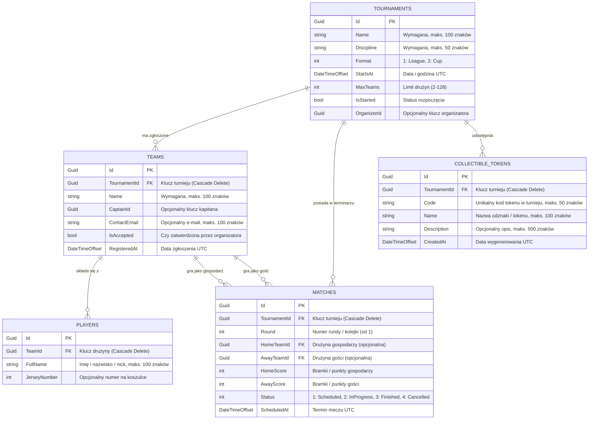

# Diagram Związków Entencji (ERD) - TurniejePro

> Zadanie: **KAN-55: Zaprojektować ERD (Turniej, Drużyna, Zawodnik, Mecz, Token)**  
> Autor: Adam Bednarski  
> Status: Zaakceptowany

Dokument opisuje model danych bazy aplikacji `TurniejePro` oraz relacje pomiędzy encjami.

---

## Diagram ERD (Mermaid)

---

## Opis relacji i reguł integralności

1. **Turniej ↔ Drużyny (`1 : N`)**
   * Każda drużyna jest przypisana do dokładnie jednego turnieju (`TournamentId`).
   * Usunięcie turnieju usuwa powiązane drużyny (`Cascade Delete`).
2. **Drużyna ↔ Zawodnicy (`1 : N`)**
   * Usunięcie drużyny usuwa jej zawodników (`Cascade Delete`).
3. **Turniej ↔ Mecze (`1 : N`)**
   * Turniej posiada listę meczów w terminarzu. Usunięcie turnieju usuwa mecze.
4. **Drużyna ↔ Mecze (`1 : N` jako gospodarz / gość)**
   * Usunięcie drużyny nie usuwa meczu (`Restrict`), aby zachować spójność historii rozgrywek.
5. **Turniej ↔ Zbieralne tokeny (`1 : N`)**
   * Każdy token należy do turnieju.
   * Nałożony jest unikalny indeks złożony na `(TournamentId, Code)` – w ramach jednego turnieju nie mogą istnieć dwa tokeny o tym samym kodzie.
